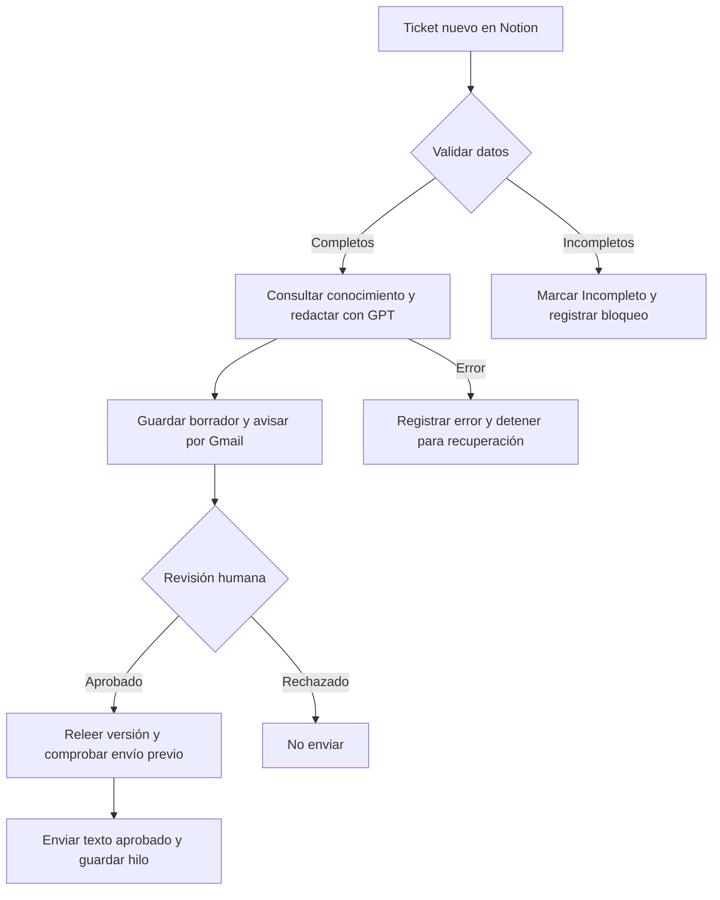
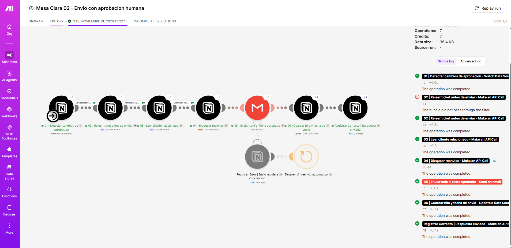

# Mesa Clara

**Automatización de soporte con revisión humana**  
Proyecto final de IA Automation · Tonny Malczewski

Mesa Clara es una empresa ficticia de software de gestión. Sus consultas de soporte se registran en Notion; Make consulta los artículos vigentes y utiliza OpenAI para preparar una respuesta. El responsable revisa el borrador antes de que Gmail envíe el texto aprobado al cliente.

El objetivo es reducir el trabajo de redacción sin delegar en la IA decisiones comerciales ni el contacto final con el cliente.

## Entrega

| Recurso | Acceso |
|---|---|
| Arquitectura y manual en PDF | [Abrir documento](docs/Mesa_Clara_Arquitectura_y_Manual.pdf) |
| Panel ejecutivo público | [Ver operaciones e indicadores](https://wobbly-muse-d95.notion.site/Panel-ejecutivo-Mesa-Clara-413a709292e981f9887feff8e745cb49) |
| Base de registros en lectura | [Ver Ejecuciones](https://wobbly-muse-d95.notion.site/a847bd21fed34a2f91f4bb96ac514454) |
| Flujos exportados de Make | [Recepción](workflows/01_recepcion.blueprint.json) · [Envío aprobado](workflows/02_envio.blueprint.json) |
| Evidencias | [Capturas originales](evidence/capturas/) · [Resultados de pruebas](tests/resultados.csv) |
| Video de demostración | [Espacio de entrega y guion](video/README.md) — pendiente de incorporar por el autor |

## Cómo funciona

La solución utiliza **Make, Notion, OpenAI y Gmail**. Se divide en dos escenarios para separar la preparación de la respuesta de su autorización. Ambos quedaron activos cada seis horas. El envío requiere texto aprobado, versiones numéricas coincidentes, fecha de aprobación y un cliente activo con correo.

## Resultado de las pruebas

Se realizaron seis ejecuciones de recepción: consultas válidas, consulta vacía, cliente ausente, una instrucción maliciosa y un error de validación provocado. La prueba T02 completó el recorrido de extremo a extremo: aprobación, correo con el texto exacto, fecha e hilo guardados y registro de éxito. La ejecución posterior no envió otro correo.

El panel se verificó sin iniciar sesión. Muestra seis registros: tres correctos, dos bloqueados y un error. La tasa de error de ese conjunto es 16,7 %; Notion la presenta redondeada como promedio 0,17. Son ensayos con fallos intencionales y registro parcial, no una medición del servicio en producción.

La prueba de error dejó una ejecución incompleta en la cola de Make. Después de documentarla, se retiró únicamente ese elemento y se verificó la desaparición del bloqueo. El historial y el registro en Notion se conservaron.

## Documentación técnica

- [Modelo de datos](docs/diccionario_datos.md) y [esquema JSON](docs/esquema_notion.json).
- [Contratos de integración](contracts/): consulta, persistencia, error y envío.
- [Costos y matriz de decisión](docs/costos_y_decisiones.md).
- [Manual de operación, privacidad y recuperación](docs/operacion_y_seguridad.md).
- [Correspondencia con la consigna](docs/cierre_entrega.md).
- [Importación y conexiones](workflows/LEER_ANTES_DE_IMPORTAR.md).

## Alcance de esta versión

La implementación utiliza GPT-5 nano con conocimiento acotado y revisión humana. Claude para lectura extensa y Batches para históricos forman parte de la estrategia de ampliación; no se declara consumo ni ahorro real de esas alternativas. La base fue diseñada mediante instrucciones a IA y el conector Notion, no con Omni AI de Airtable.

El límite de 180 palabras del prompt no es un límite técnico de tokens. Tampoco hay una transacción atómica entre Gmail y Notion ni unicidad global por Mensaje ID. La recuperación de fallos de persistencia exige conciliación, tal como detalla el manual. Las pruebas adicionales E03/E05 se identifican según el nivel de evidencia disponible.

Los blueprints originales corresponden al flujo probado. La programación se ajustó después de exportarlos y se documenta en [configuración operativa](workflows/configuracion_operativa.json). Para importarlos en otra cuenta hay que reasignar conexiones y bases.
