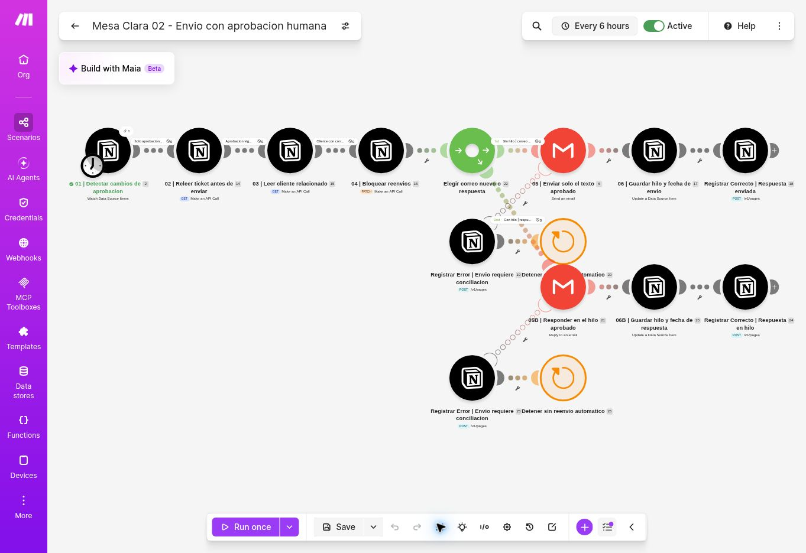

# Verificación de Gmail: correo nuevo y respuesta en hilo

Fecha: 9 de noviembre de 2026, 21:59 UTC (18:59 Argentina).

La versión importada se guardó y se volvió a abrir desde Make. El escenario 6963384 permaneció activo cada seis horas. Se exportó nuevamente después de las pruebas.

## Resultados
| Ensayo | Entrada | Resultado comprobado |
|---|---|---|
| E07 | Ticket nuevo de ensayo con Thread ID de T02 | Reply to an email envió una respuesta en el mismo hilo; Notion guardó Enviado, fecha e identificador |
| E08 | Ticket de ensayo sin Thread ID | Send an email creó un hilo nuevo; Notion guardó Enviado, fecha e identificador |
| Reejecución | Los dos tickets ya enviados | Cero pasan el primer filtro; el hilo original conserva dos mensajes (T02 + E07) y el nuevo uno |

La consulta directa de Gmail confirmó el cuerpo exacto de E07 y las cabeceras In-Reply-To y References apuntando al mensaje original. Ambos destinatarios corresponden al cliente de demostración del autor; no se contactó a un tercero.

Los ensayos E07/E08 usan texto técnico fijo y estados preparados para verificar transporte y persistencia. No son una nueva validación humana ni una generación de IA. La evidencia HITL sigue siendo T02 y la aprobación explícita del usuario.

## Identificadores de auditoría
- Ticket E07: 413a7092-92e9-8126-802f-fce3d14d240e
- Ticket E08: 413a7092-92e9-8115-ac63-d16fb62e3361
- Hilo T02/E07: 1a1c11e1ac6d8f94
- Mensaje E07: 1a1c25292a1d336e
- Hilo E08: 1a1c2528a8fb72a9

Los controles de aprobación, versión y envío previo se conservaron antes del router. Cada salida tiene su persistencia y ruta de error con Break sin reenvío automático.

La captura corresponde a la segunda ejecución; los ceros en los filtros son el resultado esperado tras haber enviado E07/E08.
